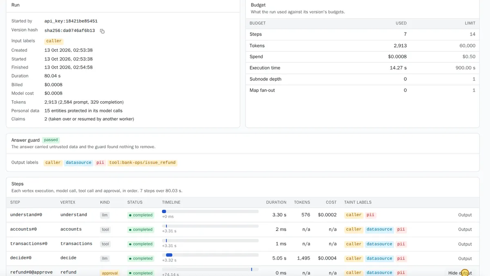

Every time an assistant handles a request, Caliban records a [conversation](../reference/glossary.md#conversation) (a `run` in the API): who started it, which version answered, every step it took, what it cost and what it used against its limits. In the console they are under **Conversations** (labelled **Runs** in consoles before the rename).

Plain model requests that no assistant handles are not conversations: find them in [Usage](usage-and-costs.md#usage).

## Read a run

1. Open **Conversations** and pick the workspace. The list is newest first. Filter by assistant, version or status.
2. Open a conversation.


*A conversation of the fintech `support-desk` assistant. It ran 7 steps in 80 s, most of it waiting for a person to approve the refund; it cost $0.0008 and protected 15 items of personal data in its model calls.*

To turn a finished conversation into a test case, choose **Save as test**. See [save a run as a test](tests-and-go-live.md#save-a-run-as-a-test).

The **Run** card:

| Field | Meaning |
|---|---|
| Started by | The API key (by its id), the console user, or a test run (`eval:<test run>:<case>`) |
| Version fingerprint | Which exact version ran (`sha256:...`) |
| Input labels | `caller` when the app marked part of its input as [untrusted](../reference/glossary.md#untrusted) |
| Created, started, finished, duration | Duration includes time waiting for a person |
| Billed, model cost | See [costs](#costs) |
| Tokens | Prompt and completion tokens of all its model calls |
| Personal data | How many items were hidden from the models |

**Status** is one of:
- `pending`, `running`, `sleeping` (waiting out a rate limit or a timer);
- `input_required`: waiting for a person, see [approvals](approvals.md);
- `succeeded`, `failed`;
- `budget_exhausted`: it reached a limit and stopped cleanly; the output holds the partial result and the reason says which limit;
- `cancelled`: someone stopped it; the output holds the partial result.

The **Budget** card shows what the conversation used against its version's limits: steps, tokens, spend, working time (not counting time waiting for a person), levels of [sub-assistants](../reference/glossary.md#sub-assistant) and tasks in parallel. See [limits](../reference/limits.md).

The **Answer guard** card says whether the [answer check](../reference/glossary.md#answer-check) ran and what it did. It runs when the answer was built from outside data. "Passed" means it found nothing to remove; when it removes a link, contact or reference that came only from untrusted text, the answer shows `[removed: text from untrusted data]`.

**Output labels** say where the answer's data came from, in plain words:

| Label | The data came from |
|---|---|
| `caller` | The app's input, marked untrusted |
| `pii` | The input, and it holds personal data |
| `datasource` | Your database, through a [query plan](../reference/glossary.md#query-plan) |
| `retrieved` | A document in a [knowledge](knowledge.md) library |
| `tool:<server>/<action>` | A [connected system](connected-systems.md) |

**Who sees what.** Every role except billing sees that a conversation happened and its metadata (steps, timings, tokens, costs, labels). The content (input, output, each step's output, questions) is your workspace's data and may hold personal data: only roles with `runs.data` see it (owner, admin, workspace admin, developer). See [people and roles](people-and-roles.md#roles).

Apps read their own conversations with the key that started them:

```sh
curl http://caliban.internal:8080/v1/runs/run_01a1332e0e8071f48917b2b82f5620db \
  -H "authorization: Bearer cal_..."
```

The answer has `status`, `output`, `partial`, `error`, `stop_reason`, `awaiting` (the step and question when it waits), `budget`, `cost_usd`, `model_cost_usd`, `usage` and `steps`. `GET /v1/runs` lists the conversations the key may see, with `?node=`, `?status=`, `?created_after=`, `?created_before=`, `?limit=` and `?cursor=`. To stop one: `POST /v1/runs/{id}/cancel` (in the console, **Cancel**). It stops at the next step boundary and keeps the partial result.

Finished conversations are deleted after 30 days by default (`CALIBAN_NODE_RUN_RETENTION_DAYS`), with the [test cases saved from them](tests-and-go-live.md#save-a-run-as-a-test). Usage and spend totals are kept.

## Delete a conversation

To erase a conversation before its retention ends, for example when a person asks for their data to be erased:

```sh
curl -X DELETE http://caliban.internal:8081/api/v1/tenants/cedar-bank/runs/$RUN_ID \
  -H "authorization: Bearer $CALIBAN_ADMIN_TOKEN"
```

It needs `runs.data` and `nodes.write`. In one step, Caliban:
- removes the test cases saved from the conversation from every test set (audited as `node.golden_set.scrub`);
- clears the stored content of test runs that used it (their summaries and verdicts stay, marked as content purged);
- deletes the conversation with its steps and events, and the test conversations made from its content (audited as `node.run.erase`).

A conversation that is still running, or a test run using it that has not finished, gives `409`: try again when it ends. Deleting again is safe. Usage events of its model calls are kept: they hold no content and are needed for billing.

Caliban keeps no index of people. To erase one person's data, find and delete each conversation that holds it.

The hourly cleanup applies the same rule to saved test cases: once a conversation is past `CALIBAN_NODE_RUN_RETENTION_DAYS`, its test cases leave their sets (audited as `node.golden_set.scrub`). Cases written by hand are kept.

## Timeline

The **Steps** card lists every step in order: each model call, database lookup, tool call, question and approval. For each step:
- **Step** id and **Vertex** (the step's name in the spec). Steps of a sub-assistant show their path in the id, such as `fanout#0/1>bug#0>triage#0`;
- **Kind**: `llm` (a model call), `tool`, `approval`, `human` (a question), and so on;
- **Status**, and the **Timeline** bar: when the step started, relative to the start of the conversation, and how long it took;
- **Duration**, **Tokens**, **Cost**;
- **Data labels**: where the data the step used came from;
- **Output** (with `runs.data`).

In the conversation above, `understand` (a model call) took 3.30 s, the two database lookups 1 to 2 ms each, `decide` 5.05 s, and the refund approval came at +74 s. Model steps take seconds; lookups take milliseconds. That is the usual shape.

To follow a conversation live from an app, stream its events (Server-Sent Events):

```sh
curl -N http://caliban.internal:8080/v1/runs/run_01a1332e0e8071f48917b2b82f5620db/events \
  -H "authorization: Bearer cal_..."
```

```text
id: 3
event: step.finished
data: {"id": 3, "type": "step.finished", "run_id": "run_...", "at": "...", "data": {"step": "accounts#0", "vertex": "accounts", "kind": "tool", "status": "completed", "duration_ms": 2, ...}}
```

Event types: `run.created`, `step.started`, `step.finished`, `run.input_required`, `run.sleeping`, `run.input_received`, `run.cancel_requested`, `run.finished`. Events never carry step content; the only text is the question of `run.input_required`. If the connection drops, reconnect with the `Last-Event-ID` header to get exactly what you missed. You can also start a conversation with `"stream": true` on `POST /v1/nodes/{name}/runs`.

## Costs

A conversation shows two amounts:

- **Billed** (`cost_usd`): what your workspace is charged. For an assistant reached through [automatic routing](../reference/glossary.md#automatic-routing) (`caliban/auto`), this is the flat `caliban/auto` price, discounted when a [cache](../concepts/caching.md) answered. Otherwise it is the model's own price.
- **Model cost** (`model_cost_usd`): what the models it was routed to really cost. It differs from Billed only for conversations billed at the flat `caliban/auto` price.

Both come from the prices in the model catalogue. Caliban ships no list prices: if a model has no price, its cost shows `$0.00`. See [models](models.md).

Each step's cost is also shown on the timeline, and the conversation's limits stop it if spend passes the version's `budgets.usd`. Workspace-wide daily and monthly caps apply too: see [spend caps](usage-and-costs.md#spend-caps).

The grader's calls during [tests](tests-and-go-live.md) are metered separately and never count in a conversation's cost.
