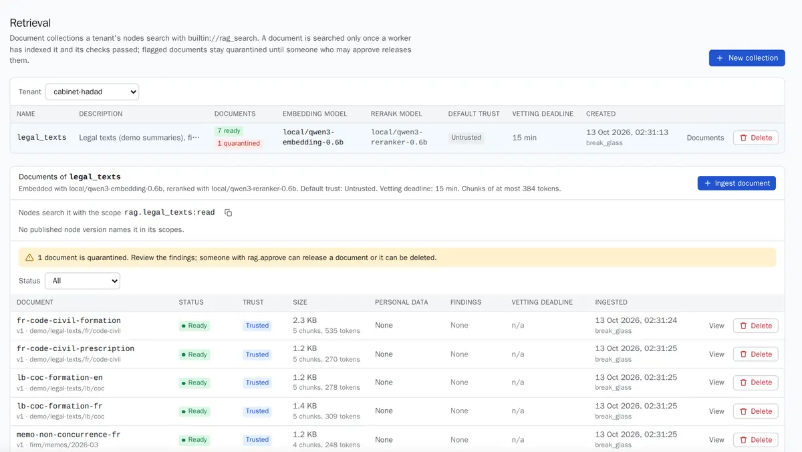

Knowledge is the set of documents your assistants can search and cite. Documents live in **document libraries** (`collections` in the API), each owned by one workspace. An assistant searches a library with the built-in document search tool, once its settings name the library.

In the console, open **Knowledge** (labelled **Retrieval** in consoles before the rename). You need `rag.write` to create libraries and upload, and `rag.approve` to release a held-back document.

## Create a library

Before you start, the workspace needs an embedding model it can reach, and ideally a rerank model. See [local models](models.md#local-models).

1. Open **Knowledge** and choose **New collection**.
2. Fill in:
   - **Name**: lowercase letters, digits and `_`, for example `legal_texts`.
   - **Description**: what it holds, for the people who manage it.
   - **Embedding model**: fixed for the life of the library. To change it, create a new library and upload again.
   - **Rerank model**: optional, recommended. It reorders the best results of every search.
   - **Default trust**: whether documents uploaded without a trust level come **from your team** (`trusted`) or **from outside** (`untrusted`, the default).
3. Leave the advanced fields at their defaults unless you have a reason: **Chunk size** 384 tokens, **Navigation from** 24 chunks, **Vetting deadline** 900 seconds.
4. Save.

Then let an assistant search it: add `rag.<library>:read` to its scopes, for example `rag.legal_texts:read`, with the tool `builtin://rag_search`. See [the assistant spec](../reference/assistant-spec.md). The library page shows the exact scope to copy, and which published versions use it.

## Upload documents

1. On the library, choose **Ingest document**.
2. Pick a **File**, or paste the **Text**.
3. Set the **Format**: Markdown (default), HTML or plain text.
4. Fill in:
   - **Document id**, for example `travel-policy`. Uploading the same id again adds a new version.
   - **Title**, shown in citations.
   - **Source**, where it came from (a path or URL).
   - **Trust**: from your team or from outside.
   - **Valid from** and **Valid until**, optional. Out of that window, the document is not searched.
5. Save.

The document is **Pending**, then **Ready** once a worker has indexed it and its checks passed. Nothing is searchable before that. Until a new version is ready, the previous one is still served.

Rules:
- **No PDF or office files.** Convert them to Markdown or text first. HTML and Markdown keep their headings, lists, tables and code, and search results cite the heading path.
- At most 5 MB of text per document.
- The document id and source are stored in clear: keep personal data out of them. The title and content are encrypted under the workspace's key and never shown again.
- Personal data in the text is replaced before it is indexed. A document that contains a credential fails.

:::caution[Coming soon]
Uploading many files at once, by drag and drop, and PDF and Word extraction. Today, the console takes one document at a time; for a batch, loop over `POST /api/v1/tenants/{t}/rag/collections/{c}/documents` with `{"doc_id", "content", "title", "content_type", "source", "trust"}`, as the health and law demos did.
:::

## Held-back documents

Every document is scanned for hidden instructions, hidden characters, requests to send data out, and links. Documents from outside are also compared with the rest of the library, to catch near-copies of real passages planted to change answers.

- A document **from outside** with any finding other than a link is **held for review** (`quarantined`). It is never searched until someone releases it.
- A document **from your team** is held only for hidden characters. Its other findings are recorded.
- A document from outside whose checks do not pass within the **vetting deadline** fails, rather than becoming visible later.

*The law demo: seven legal texts are ready; a client upload carrying an instruction and a link is held, with a warning above the list.*

To review a held-back document:

1. Open the library. A banner says how many documents are held.
2. Set **Status** to quarantined, and choose **Review** on the document.
3. Read the **Scan findings**. Each one names the chunk and the headings above it, never the text that triggered it.
4. Either delete the document, or tick **I have read these findings and release this document** and choose **Release**. A released document is indexed again, with a fresh vetting deadline.

Releasing needs `rag.approve`, which is separate from uploading: by default `owner`, `admin` and `tenant_admin` have it, `developer` does not. Each release is audited with its findings.

Even a released document stays **untrusted data**: an assistant reads it as information, never as instructions. See [the safety model](../concepts/safety-model.md).
