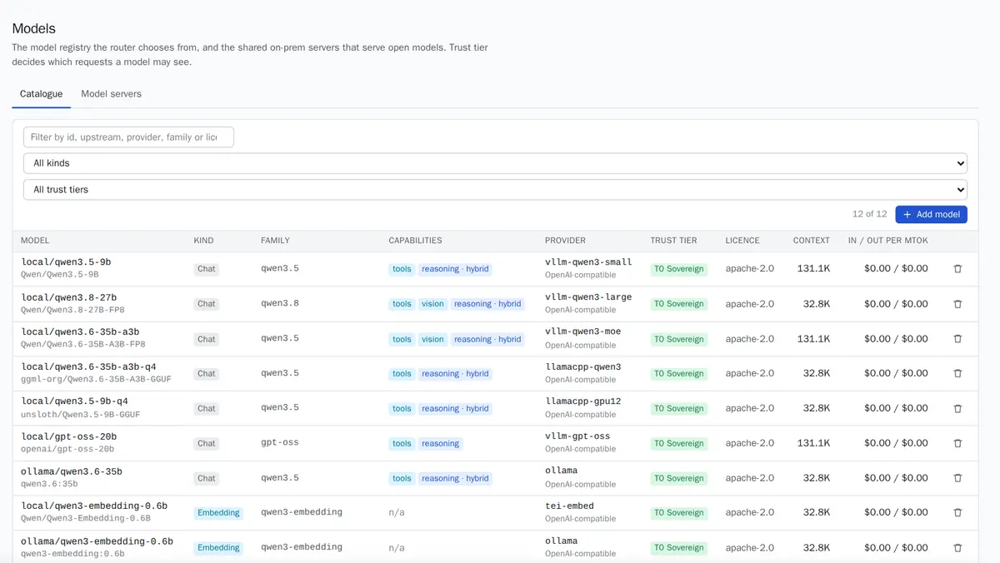

Caliban answers with models you register. A model runs either on a **model server** you operate (vLLM, SGLang, llama.cpp, Ollama, TEI) or at an outside provider you pay with your own account (OpenAI, Anthropic). Caliban never pools provider keys.

You need the `admin` or `owner` role. In the console, open **Models**. It has two tabs: **Catalogue** (the models) and **Model servers**.

*The catalogue from the 2026-10-13 demo: Qwen, gpt-oss and embedding models, each served by an on-prem server and marked T0 Sovereign.*

## Add a model server

A model server is a shared, OpenAI-compatible endpoint that every allowed workspace can use.

1. Open **Models**, then **Model servers**, then **Add model server**.
2. Fill in:
   - **Server ID**: a short id such as `vllm-qwen3-large`. Models name it as their provider.
   - **Kind**: `openai_compatible` for vLLM, SGLang, llama.cpp, Ollama and TEI.
   - **Base URL**: the server's `/v1` endpoint as the gateway reaches it, for example `http://qwen3-30b:8000/v1`.
   - **Trust tier**: where the model runs. See [trust tiers](#trust-tiers-in-plain-words) below.
   - **API key**: only if the server was started with `--api-key`. It is sealed at rest and never shown again.
   - **Tenant allow-list**: workspace ids that may use it. Leave it empty to share it with every workspace.
   - **Cache salt**: turn it on for a vLLM pool shared by several workspaces. Each workspace then gets its own prefix cache.
3. Save. The **Health** column shows whether the server answers on its `/models` endpoint. The console probes it every 15 seconds while the page is open.

The API equivalent is `POST /api/v1/providers` with `id`, `kind`, `base_url` and `trust_tier`. `GET /api/v1/providers/{id}/health` runs the same probe.

## Add a model

The fastest way is discovery: Caliban asks the server what it serves and suggests catalogue entries.

1. On **Model servers**, choose **Discover models** on the server.
2. Pick the models to add. Check each suggestion: the licence, family and context window are guesses, so confirm them on the model card.
3. Save. The models appear in **Catalogue**.

To add a model by hand, open **Catalogue**, then **Add model**:

| Field | What to enter |
|---|---|
| Model ID | What your apps send as `model`, for example `local/qwen3-8b` |
| Provider | A model server id, or a provider account id of a workspace |
| Upstream model | The name the server expects, for example `Qwen/Qwen3-8B` |
| Kind | `chat`, `embedding` or `rerank` |
| Trust tier | Where it runs |
| Licence | The SPDX id from the model card, for example `Apache-2.0` |
| Context window | In tokens |
| Price in, price out | USD per million tokens. Leave them blank for self-hosted models |

Capabilities say what the model can do: **Tools**, **Vision**, and **Reasoning** (`none`, `always` or `hybrid`). A hybrid model, such as Qwen3, thinks or not per call. Set **Reasoning control** to `enable_thinking` for those, so each assistant step and each request can switch thinking off (`"caliban": {"reasoning": "off"}` in the request body).

No list prices ship with Caliban. Copy them from your provider. Without prices, Caliban still meters tokens but reports a cost of zero.

Through the API: `POST /api/v1/models`. Discovery is `POST /api/v1/providers/{id}/discover`. A model a route still uses cannot be deleted (`409`).

## External providers

To use OpenAI, Anthropic or another outside provider, the workspace brings its own account. Caliban calls the provider with that workspace's key only.

1. Open the workspace (**Tenants** in consoles before the rename), then the **Provider keys** tab.
2. Choose **Add provider key**. Pick the **Provider**, give it a **Label**, paste the **API key**, and set the **Trust tier** (`T2 Contracted` if you have a data processing agreement and zero retention, `T3 Public` otherwise).
3. Register the provider's models in the catalogue with that provider id.

The key is encrypted at rest (AES-256-GCM, under the workspace's own data key) and write-only: the console shows its last four characters. See [provider accounts](workspaces.md#provider-accounts).

Before any personal data reaches an outside model, Caliban replaces it. See [How privacy works](../concepts/how-privacy-works.md).

:::note[Outbound calls are allow-listed]
With `[security] egress = "deny_by_default"` in the deployment config, the gateway only calls the base URLs you declared. An air-gapped install declares only its own model servers.
:::

## Local models

Open-weight models on your own GPUs or CPUs are first-class. Point Caliban at the server and mark the models `T0 Sovereign`.

- **vLLM and SGLang** for GPU pools. Turn on **Cache salt** when several workspaces share the pool.
- **llama.cpp and Ollama** for smaller machines and quantised models (GGUF).
- **TEI** for embedding and rerank models, which [knowledge](knowledge.md) libraries and automatic routing use.

In the demo, one L40S GPU served `Qwen/Qwen3.8-27B-FP8` through vLLM, plus `Qwen3-Embedding-0.6B` and `Qwen3-Reranker-0.6B`. Topic classification with that embedder took about 5 ms per request.

### Trust tiers in plain words

| Console label | Plain meaning | Personal data by default |
|---|---|---|
| T0 Sovereign | On your servers (on-prem or your own cloud account) | Sent as is, unless the workspace turns protection on for these models |
| T1 Attested | A verified enclave (confidential computing with attestation) | Sent as is, same switch |
| T2 Contracted | A provider under contract (DPA, zero retention) | Always replaced first |
| T3 Public | A public provider without data guarantees | Always replaced first |

The tier also decides which requests a model may see. See the [glossary](../reference/glossary.md#trust-tier).
