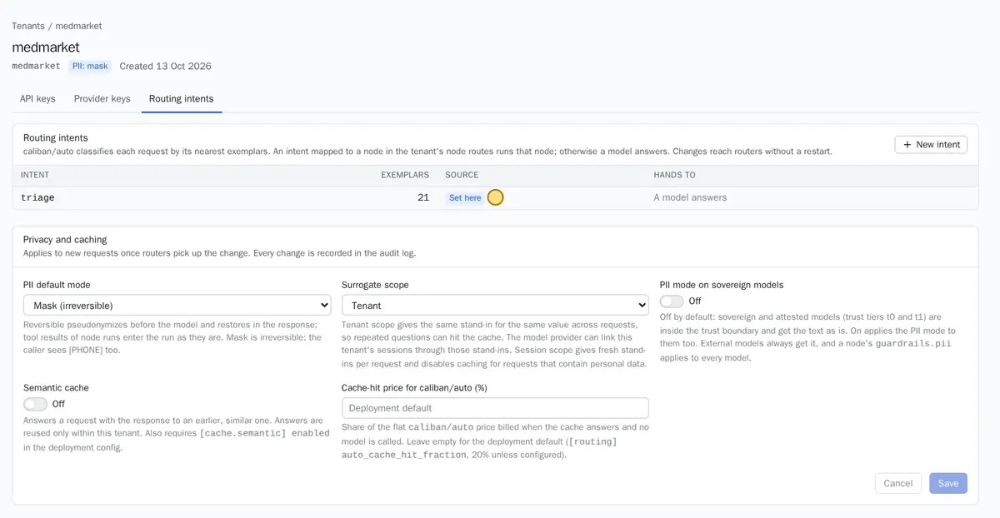

A workspace (`tenant` in the API) is a separate space with its own keys, data, assistants, topics, cache and budget. Nothing crosses between workspaces: not cached answers, not personal-data placeholders, not usage. Create one per customer, department or environment.

In the console, workspaces are under **Workspaces** (labelled **Tenants** in consoles before the rename). Each workspace page has tabs for API keys, provider keys and topics, and cards for privacy, detectors, limits, and deletion.

## Create

1. Open **Workspaces** and choose **New tenant**.
2. Enter a **Name**: lowercase, such as `acme-finance`. It is also the id, and it can never be reused, even after deletion.
3. Optionally set a **Region**, a label for data residency such as `eu-west-1` or `on-prem-dc1`.
4. Pick the **Default PII handling**. Keep **Reversible pseudonymization** unless you have a reason not to. See [Privacy](privacy.md#modes).
5. Save.

Then, in this order:
1. Give the workspace a model: a [provider account](#provider-accounts), or access to a shared [model server](models.md#add-a-model-server).
2. [Create an API key](#apps-and-keys) for each app.
3. Send a first request. See the [gateway quickstart](../start/gateway-quickstart.md).

The API equivalent is `POST /api/v1/tenants` with `{"name": "acme-finance", "pii_default": "reversible"}`.

:::note
Deleting a workspace revokes all its keys, destroys its provider keys and its data key, and removes its routes. Its audit history stays. Use **Delete tenant** at the bottom of the workspace page, and type the name to confirm.
:::

## Privacy

The **Privacy and caching** card holds the settings that apply to every request of the workspace:


*The medmarket workspace from the demo: one topic, "triage", with 21 example sentences, and personal data set to Mask.*

| Setting (console label) | Plain meaning |
|---|---|
| PII default mode | How personal data is protected: hide and restore, hide everywhere, or off |
| Surrogate scope | Whether the same person gets the same placeholder across requests (`Tenant`) or a fresh one each time (`Session`) |
| PII mode on sovereign models | Also hide personal data from models on your own servers |
| Semantic cache | Reuse answers to similar questions within this workspace |
| Cache-hit price for caliban/auto (%) | What a cached answer costs the workspace, as a share of the normal price |

Every change is audited and reaches the gateways without a restart. The [privacy guide](privacy.md) explains each choice, and the **Personal data detectors** card adds your own identifier formats and names.

## Limits and budget

Two kinds of limits protect a workspace.

**Assistant limits** (the **Node limits** card) cap what any assistant version may declare, and what assistants may spend together:

| Field | Plain meaning | Default |
|---|---|---|
| Steps per run | Steps of one conversation that call a model, a tool or a person | 200 |
| Tokens per run | Tokens processed in one conversation | 2,000,000 |
| Wall clock per run (seconds) | Working time, not counting time waiting for a person | 3,600 |
| Subnode depth | Levels of assistants calling assistants | 5 |
| Map fan-out | Tasks in parallel | 32 |
| USD per run | When set, every assistant must declare its own cost limit within it | none |
| Daily spend cap, Monthly spend cap (USD) | What all assistants of the workspace may spend per UTC day and month | none |

When a spend cap is reached, conversations end gracefully with what they have so far (`budget_exhausted`). Lowering the caps does not change versions already published, but a version that no longer fits cannot go live.

In the demo, the developer workspace saw its spend against these caps through `GET /api/v1/tenants/{t}/node-spend`, which returns `today_usd`, `month_usd`, `caps` and `remaining`.

**Request limits** (requests per minute per workspace and per key, tokens per minute and per day, USD per day) are set in the deployment config file today:

```toml
[limits.tenants.cedar-bank]
requests_per_minute = 600
key_requests_per_minute = 60
tokens_per_minute = 200000
tokens_per_day = 20000000
usd_per_day = 50
```

A request over a limit gets `429` with a `retry-after` header. See [Limits](../reference/limits.md).

:::caution[Coming soon]
Setting request limits on the workspace and key forms in the console. Today, edit `[limits.tenants.<id>]` in the config file and restart the gateways, as the fintech demo did.
:::

## Apps and keys

Each app gets its own API key, so you can see its usage and revoke it alone.

1. Open the workspace, tab **API keys**.
2. Type a **Key name** such as `support-desk-app`, and choose which assistants it may run: every published one, only some, or none.
3. Choose **Mint key**. Copy the key now: it starts with `cal_` and is shown once.

See [API keys](api-keys.md) for scopes and rotation.

## Provider accounts

A provider account (BYOK, bring your own key) lets the workspace use an outside model with its own contract and bill.

1. Open the workspace, tab **Provider keys**, then **Add provider key**.
2. Pick the provider (OpenAI, Anthropic, or an OpenAI-compatible endpoint), a label, the API key and the trust tier.
3. Register the models it serves in the catalogue. See [external providers](models.md#external-providers).

The key is encrypted at rest under the workspace's own data key, and never returned (the console shows the last four characters). A provider key that a route still uses cannot be removed (`409`).

You can also add a local, keyless OpenAI-compatible endpoint here when only one workspace should use it.
