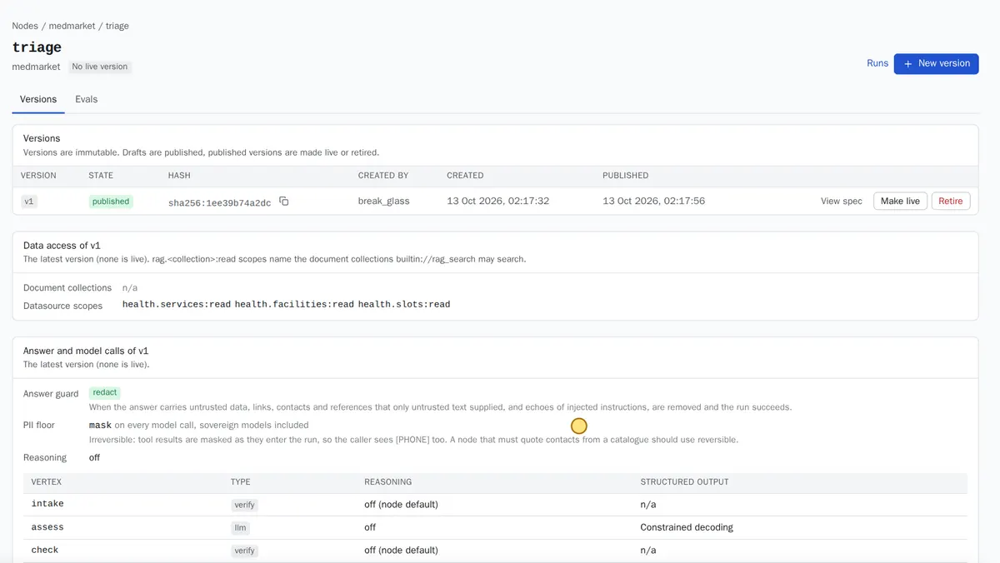
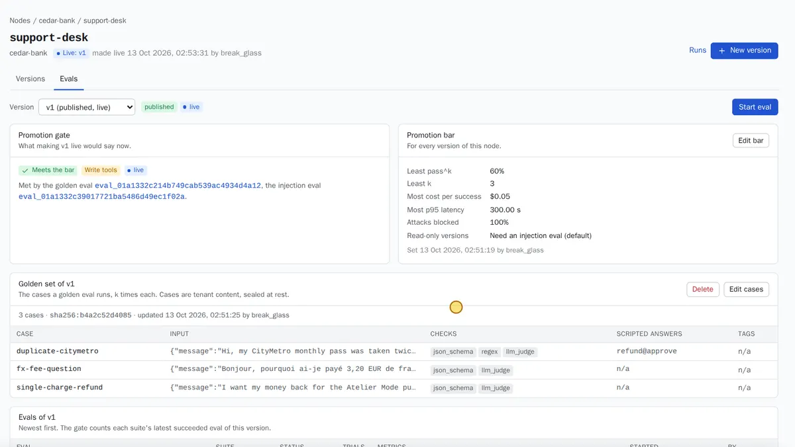

An [assistant](../reference/glossary.md#assistant) (`node` in the API) answers one kind of request with your data, your tools and your limits. In this tutorial you build one in four steps: pick a starting point, connect its data, try it, and put it live once its tests pass.

The worked example is the **triage** assistant of a medical marketplace, recorded on 2026-10-13 in the `medmarket` workspace. A patient describes symptoms in English, French or Arabic. The assistant judges how urgent it is, looks up services, clinics and free slots in the marketplace's MongoDB database, and recommends a service with the next slot.

:::caution[Coming soon: the four-step builder]
The console will guide you through these four steps in one place: pick a template, connect data, try it, go live, ending on a review screen that shows every setting it chose for you. That builder is not built yet. Each step below says what to do **today**, with the pages and API calls that exist now. Today's path asks for some JSON; plan on help from someone technical for the first assistant.
:::

## Before you start

- An administrator has installed Caliban, added a chat model and created your workspace. See [Install and check](install.md).
- You can sign in to the console with a role that may edit and publish assistants. See [People and roles](../guides/people-and-roles.md#roles).
- For an assistant that reads a database: a read-only MongoDB user for that database.

## Pick a template

**The intended flow.** You answer one question, "what do you want to build?", and pick a template: triage, legal research, support desk. A template comes with its instructions, its steps, sensible limits and a set of test cases. You change the name and the wording, not the structure.

:::caution[Coming soon: templates]
Assistant templates are not in the console yet. Today, start from an existing assistant definition (the [assistant spec](../reference/glossary.md#assistant-spec), a JSON document) and adapt it.
:::

**Today:**

1. Take a starting spec. Caliban ships a reference triage assistant in its source, `config/nodes/triage.node.json`. The four recorded scenarios have one each: `triage` (health), `legal-assistant` with two sub-assistants (law), `support-desk` (fintech) and five small assistants written in Python (developer). Your Caliban contact can give you the one closest to your case.
2. Open **Assistants** (labelled **Nodes** in consoles before the rename) and choose **New node**. Pick the workspace and paste the spec. When you save, Caliban checks it against the [assistant spec](../reference/assistant-spec.md) and lists every problem it refuses, one by one.
3. Change the name, the instructions (`prompt`), and the limits under `budgets` if you need to. Save. You now have version 1 as a **draft**.

See [Assistants](../guides/assistants.md#create-from-template) for the details.

## Connect data

An assistant can only read data that a person has approved, through names your team chose. Connecting data has two parts: a [data connection](../reference/glossary.md#data-connection) to the database, and the [data dictionary](../reference/glossary.md#data-dictionary) that says what its collections and fields mean.

**The intended flow.** The builder asks which database, scans it, and shows only the dictionary entries this assistant uses, for you to accept in one step.

**Today:**

1. **Connect the database.** Open **Data connections** (labelled **Datasources**), add a MongoDB connection with a read-only user, and start a scan. The scan reads the structure and a sample of the data, and suggests dictionary entries. See [Data connections](../guides/data-connections.md#connect-mongodb).
2. **Approve the dictionary.** Open **Data dictionary** (labelled **Ontology**). Review the suggested entries: services, facilities and slots in the triage example. Approve the ones the assistant needs. The assistant can only query approved entries. See [Data dictionary](../guides/data-dictionary.md#review-suggestions).
3. **Name what the assistant may read.** In the spec, `datasources.scopes` lists what it may read, for example `health.services:read`, `health.facilities:read` and `health.slots:read`. Caliban refuses to publish a version whose scopes name data that is not approved.

For documents (policies, guides, legal texts) instead of a database, create a document library in [Knowledge](../guides/knowledge.md#create-a-library) and give the assistant the scope `rag.<library>:read`.

## Try it

**The intended flow.** A **Try it** panel next to the assistant: type a message, see the answer, then open the conversation to see each step, its time and its cost.

:::caution[Coming soon: Try it]
The console has no Try it panel yet. Today, send a message through the gateway with an API key, then read the conversation in the console.
:::

**Today:**

1. **Publish the draft without making it live.** On the assistant's **Versions** tab, publish version 1. A published version can be run by name and tested, but it does not answer anyone yet. Caliban checks the spec, the data it may read, its limits and its tools at this point, and lists any problem.
2. **Mint a key** in your workspace (see [API keys](../guides/api-keys.md#create)).
3. **Send a message** to the version:

```sh
curl http://caliban.internal:8080/v1/nodes/triage/runs \
  -H "authorization: Bearer cal_..." -H "content-type: application/json" \
  -d '{"version": 1, "chat": {"messages": [{"role": "user",
       "content": "I have had chest pain and palpitations since Tuesday and I am in Beirut."}]}}'
```

4. **Read the conversation.** Open **Conversations** (labelled **Runs**) and pick the newest one. You see each step in order, with its time, tokens and cost. See [Conversations and runs](../guides/conversations-and-runs.md#read-a-run).



*The `triage` assistant after publishing: version 1 is published but there is no live version yet. The page shows what it may read and how each step calls the model.*

In the recording, triage answers took about 12.5 seconds (median) end to end: about 3.7 s to assess the case, 1 to 2 ms for each of the three database lookups, and about 11 s to write the recommendation. The message in English carried a name, an ID number, a phone number and an e-mail address. Caliban protected six items of personal data in the assistant's model calls (`x-caliban-pii-entities: 6`). Names were not among them: hiding names needs the name detection component, which that install did not run.

## Go live

An assistant goes live only when its tests pass the bar you set. Tests are example conversations with a description of a good answer.

**The intended flow.** One **Go live** button runs the checks one after the other and stops with a plain reason if one fails, such as "2 of 6 tests failed; the go-live rule is 80%".

:::caution[Coming soon: the Go live button]
Going live is three separate steps today: write the test cases, run the tests, then make the version live. The **Evals** tab of the assistant holds all three.
:::

**Today**, on the assistant's **Evals** tab:

1. **Write the test cases.** Choose **Edit cases** and enter the test set: each case has an input and the checks a good answer must pass (fields it must have, a pattern it must match, or a description that a [grader](../reference/glossary.md#grader) model checks). The triage example has six cases. See [Tests and going live](../guides/tests-and-go-live.md#test-cases). Later, grow the set from real conversations with **Save as test** ([save a run as a test](../guides/tests-and-go-live.md#save-a-run-as-a-test)).
2. **Set the bar.** Choose **Edit bar**. The bar says how many cases must pass, and how many times in a row each must pass. The health example asks for 80% of cases passing all 3 tries. See [The bar](../guides/tests-and-go-live.md#the-bar).
3. **Run the tests.** Choose **Start eval** for the test set. An assistant that can read documents or call tools must also pass the [safety tests](../reference/glossary.md#safety-tests): attacks hidden in the data it reads.
4. **Make it live.** When the gate says the version meets the bar, choose **Make live** on the **Versions** tab. Callers that name the assistant now get this version.



*The fintech `support-desk` assistant: the latest test and safety runs meet its bar, so version 1 could go live.*

**What the recording showed.** The triage assistant passed all 6 cases 3 times out of 3 (18 of 18) against a bar of 80%, and blocked all 9 attacks of the safety tests. The fintech support desk passed 2 of its 3 cases (67%), which met its bar only because that bar was set to 60%. One case failed for a real reason: the assistant refused a refund with the wrong explanation. Set the bar where a failure like that would stop the release.

### Send requests to it

Once live, apps reach the assistant three ways:

- **By name:** `POST /v1/nodes/triage/runs`, as in [Try it](#try-it), without `version`.
- **As a model:** any OpenAI client with `model: "node/triage"`.
- **Automatically:** send the topic `triage` to the assistant, and every `caliban/auto` request that Caliban sorts into that topic runs it. See [Topics](../guides/topics.md#send-to-an-assistant).

In the recording, the marketplace app sent all its messages to `caliban/auto`. Triage messages in three languages went to the assistant (topic confidence 0.999). A request for Python code went to a plain model instead, with the reason `no_node_for_intent`.

## Next steps

- [Approvals](../guides/approvals.md): when an assistant may change something (a refund, a booking), a person approves each change.
- [Assistants and versions](../concepts/assistants-and-versions.md): why versions never change once published.
- [The safety model](../concepts/safety-model.md): how data from outside is kept from steering the assistant.
