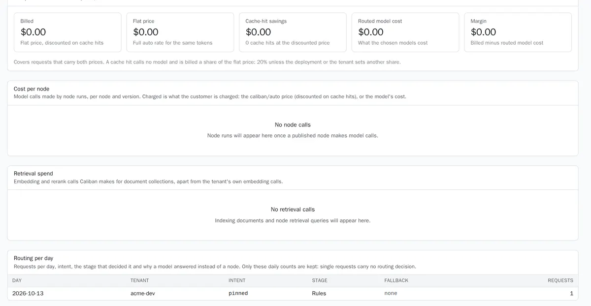

Your application already talks to a model through an OpenAI-compatible client. In this quickstart you change two settings (the base URL and the key) so that every request goes through Caliban first. Then you turn on personal-data protection and find your request in the console.

It takes about five minutes. You change no application code beyond the client setup.

## Before you start

You need four things. If you installed Caliban yourself, [Install and check](install.md) gets you all four.

- **A running Caliban.** Apps call the gateway address, port `8080` by default. This page uses `http://caliban.internal:8080`.
- **A workspace** ([Workspace](../reference/glossary.md#workspace), `tenant` in the API). It holds your keys, settings and usage, apart from every other workspace.
- **A model the workspace may use.** Either a model server on your own hardware, or your own account with a provider such as OpenAI. See [Models](../guides/models.md).
- **An API key for the workspace.** It starts with `cal_`. See [API keys](../guides/api-keys.md#create).

Ask your Caliban administrator for the model id to use. You can also list the models your key may use:

```sh
curl http://caliban.internal:8080/v1/models -H "authorization: Bearer cal_..."
```

## Point your app

Point your OpenAI client at Caliban: the base URL is the gateway address with `/v1`, and the key is your `cal_...` key. Nothing else changes.

### Python

```python
from openai import OpenAI

client = OpenAI(base_url="http://caliban.internal:8080/v1", api_key="cal_...")

resp = client.chat.completions.create(
    model="local/qwen3.8-27b",
    messages=[{"role": "user", "content": "In two sentences: what can an AI assistant do for a SaaS support team?"}],
    max_tokens=200,
)
print(resp.choices[0].message.content)
```

### TypeScript

```ts
import OpenAI from 'openai';

const client = new OpenAI({ baseURL: 'http://caliban.internal:8080/v1', apiKey: 'cal_...' });

const resp = await client.chat.completions.create({
  model: 'local/qwen3.8-27b',
  messages: [{ role: 'user', content: 'In two sentences: what can an AI assistant do for a SaaS support team?' }],
  max_tokens: 200,
});
console.log(resp.choices[0]?.message.content);
```

### curl

```sh
curl -i http://caliban.internal:8080/v1/chat/completions \
  -H "authorization: Bearer cal_..." -H "content-type: application/json" \
  -d '{"model": "local/qwen3.8-27b",
       "messages": [{"role": "user", "content": "In two sentences: what can an AI assistant do for a SaaS support team?"}],
       "max_tokens": 200}'
```

This is the first request of the developer scenario recorded on 2026-10-13 (the recording used Qwen3.8-27B on one GPU). The answer comes back in the usual OpenAI shape. Streaming (`stream: true`), tools and the other OpenAI parameters work as before.

### What Caliban tells you

Every answer carries headers that say what Caliban did. With `curl -i` you see them directly:

```http
x-caliban-request-id: req_01a133...
x-caliban-routed-model: local/qwen3.8-27b
x-caliban-intent: pinned;confidence=1.000;stage=rules
x-caliban-cache: bypass
Server-Timing: auth;dur=0.858, route;dur=0.016;desc="pinned", pii;dur=0.032, upstream;dur=905.877, upstream_total;dur=905.932, total;dur=907.284
```

- `x-caliban-routed-model` is the model that answered.
- `x-caliban-intent` says `pinned`: you named a model, so Caliban did not choose one.
- `x-caliban-cache` says whether a cached answer was used (`bypass`: no cache applied to this request).
- `x-caliban-cost-usd` (not shown) is the cost at the prices set for the model, and `x-caliban-pii-entities` counts the personal data protected.
- `Server-Timing` lists the time of each stage in milliseconds. Here Caliban added about 1.4 ms to a 906 ms model call (a recorded request from the fintech scenario).

The full list is in [Response headers](../reference/response-headers.md). In the Python OpenAI SDK, read them with `client.chat.completions.with_raw_response.create(...)` and `raw.headers`. In TypeScript, add `.withResponse()` and read `response.headers`.

### Let Caliban choose the model

Use the model id `caliban/auto` and Caliban picks the model for each request. It sorts the message into a [topic](../reference/glossary.md#topic) by comparing it with example sentences, then sends it to the cheapest model your workspace allows for that topic. If an [assistant](../reference/glossary.md#assistant) handles the topic, the assistant answers instead.

```python
resp = client.chat.completions.create(
    model="caliban/auto",
    messages=[{"role": "user", "content": "I was charged twice for my subscription this month."}],
)
```

A recorded answer from the developer scenario (five topics, examples in English, French and Arabic):

```http
x-caliban-intent: billing;confidence=0.999;stage=knn
x-caliban-routed-model: dev/qwen3.8-27b
Server-Timing: auth;dur=0.010, route;dur=5.342;desc="knn", embed;dur=5.266, pii;dur=0.022, upstream;dur=6373.522, upstream_total;dur=6373.592, total;dur=6379.061
```

Choosing the topic took 5.3 ms. Across the four recorded scenarios it took 5.2 to 5.9 ms at the 95th percentile. [How routing works](../concepts/how-routing-works.md) explains the choice, and [Topics](../guides/topics.md) shows how to add your own.

### Caliban SDKs and the Anthropic SDK

- **Anthropic SDK.** Caliban also serves the Anthropic Messages API. Set the base URL to the gateway address **without** `/v1` (`http://caliban.internal:8080`) and the API key to your `cal_...` key.
- **Caliban SDKs.** The Python and TypeScript SDKs wrap the same API, parse the `x-caliban-*` headers for you and add the admin API. See [SDKs](../reference/sdks.md). You do not need them for this quickstart.

### A model you already use outside

If your workspace uses its own provider account (OpenAI, Anthropic, or any OpenAI-compatible service), your administrator adds that account to the workspace and the model to the catalogue once. Your app keeps talking to Caliban only. See [Provider accounts](../guides/workspaces.md#provider-accounts) and [External providers](../guides/models.md#external-providers).

:::caution[Gemini is untested]
Google offers an OpenAI-compatible endpoint for Gemini, `https://generativelanguage.googleapis.com/v1beta/openai/`. In principle you add it as a provider account of kind `openai_compatible` with that base URL and your Google API key, then a catalogue model whose upstream name is the Gemini model id. Caliban only calls base URLs that are declared, and the network path to Google must be opened for the gateway. Nobody has tested this setup with Caliban yet: try it on a test workspace first, and check streaming, tool calls and usage counts before you rely on it.
:::

## Protect personal data

Caliban can hide names, card numbers, IBANs, phone numbers, e-mail addresses and your own identifier types before a model sees them. Each workspace chooses how:

| Mode | The model sees | Your app gets back |
|---|---|---|
| **Hide and restore** (`reversible`) | Realistic stand-ins (a valid-looking card number, a valid IBAN) | The answer with the real values put back |
| **Hide everywhere** (`mask`) | Placeholders such as `[PHONE]` | The placeholders |
| **Off** (`off`) | The text as sent | The answer as written |

To turn it on, open the workspace, find **Privacy and caching** (the tenant page in consoles before the rename) and set **PII default mode** to **Reversible pseudonymization**. The steps and the options are in [Privacy](../guides/privacy.md#modes).

:::note[Models on your own servers]
Models on your own servers and in verified enclaves get the text as it is by default, because it never leaves your boundary. To hide personal data from them too, switch on **PII mode on sovereign models** in the same card. Models at outside providers always get the protected text.
:::

Here is what that looks like. The fintech scenario sent this support ticket (fictional customer) to a model on the bank's own servers, with the workspace in reversible mode and protection on for its own models:

```json
{
  "model": "local/qwen3.8-27b",
  "temperature": 0,
  "max_tokens": 220,
  "messages": [
    {"role": "system", "content": "You are the triage assistant of Cedar Bank's support desk. Write a three-line case note for the agent: line 1 the problem, line 2 the card number and the IBAN exactly as the customer wrote them, line 3 the phone number and e-mail address exactly as written. No other text."},
    {"role": "user", "content": "Hello, I was charged twice by StreamBox on 3 October, 12.99 EUR each time, with my card 4539 1488 0343 6467. Please refund the duplicate to my account FR65 1273 9000 0100 0123 4567 842. You can reach me on +33 6 12 48 90 17 or at lina.haddad@example.com. Thanks, Lina Haddad"}
  ]
}
```

- The model received none of the identifiers, and not the name either (the bank's customer names are in the workspace [dictionary](../guides/privacy.md#dictionary)). It got stand-ins instead: a card number that passes the Luhn check and an IBAN that passes the mod-97 check, so it could still reason about them.
- The case note that came back held the real card number, IBAN, phone and e-mail, restored by Caliban from that request's own lookup table. Nothing is stored that maps stand-ins back to real values.
- `x-caliban-pii-entities` counts what was protected. The protection step took 0.4 ms of this request.

[How privacy works](../concepts/how-privacy-works.md) explains stand-ins and what is restored. To check what a model received, see [Check what the model saw](../guides/privacy.md#check-what-the-model-saw).

## See the request

Every request is metered. Open **Usage** in the console and pick your workspace. Your request is in the table at the bottom, with its tokens, cost, cache result and the model that answered. The cards at the top sum what was billed and what reused answers saved.



*The Usage page of the `acme-dev` workspace after its first request: one request, routed by a rule (`pinned`) because it named a model.*

To find one request, copy its `x-caliban-request-id` header. Administrators can also read usage through the admin API:

```sh
curl "http://caliban.internal:8081/api/v1/usage?tenant_id=acme-dev" \
  -H "authorization: Bearer $CALIBAN_ADMIN_TOKEN"
```

Usage keeps no per-request record of which topic a message went to: topics are only counted per day, because they can reveal what people ask about. Your app still sees its own topic in `x-caliban-intent`. See [Usage and costs](../guides/usage-and-costs.md#usage).

### Try the cache

Send the same request twice at `temperature: 0`. The second answer comes from the cache without calling the model. In the fintech scenario, the help-centre question "How much does an international transfer cost, and how long does it take to arrive?" took 1,259 ms the first time and 2.2 ms the second time, end to end:

```http
x-caliban-cache: hit
x-caliban-cache-tier: exact
Server-Timing: auth;dur=0.934, route;dur=0.016;desc="pinned", pii;dur=0.045, cache;dur=0.018;desc="hit", total;dur=1.324
```

A cache hit sends zero tokens to the model. See [Caching](../concepts/caching.md).

## Next steps

- [Topics](../guides/topics.md): teach `caliban/auto` the kinds of requests your app sends.
- [Your first assistant](first-assistant.md): answer from your own data, with tests before it goes live.
- [API keys](../guides/api-keys.md): one key per app, with its own limits.
- [Errors](../reference/errors.md): what a `401`, `403` or `429` means and what to do.
